# Najeeb Ullah — Portfolio + CMS

A Next.js 16 portfolio for **Najeeb Ullah, Mobile Game Developer**, with a built-in admin dashboard at `/admin` for editing every piece of content, images, layout and theme.

- **Stack:** Next.js 16 (App Router) · React 19 · TypeScript (strict) · Tailwind CSS 4 · MongoDB + Mongoose · Auth.js v5 · Zod · React Hook Form · ImageKit (images + resume) · Resend (email) · dnd-kit · Motion · Vitest · Playwright
- **Specs:** [`CLAUDE.md`](CLAUDE.md) and [`docs/`](docs) (PRD, design system, architecture, admin spec, plan, QA). Deviations are logged in [`docs/DECISIONS.md`](docs/DECISIONS.md).
- **For Najeeb:** see [`HANDOVER.md`](HANDOVER.md).

## Feature walkthroughs

Short previews of every feature (2× speed). Click a preview for the full video with step-by-step captions. More details in [`videos/README.md`](videos/README.md).

<table>
<tr>
<td align="center" valign="top" width="50%">
<a href="videos/12-landing-page-desktop.mp4">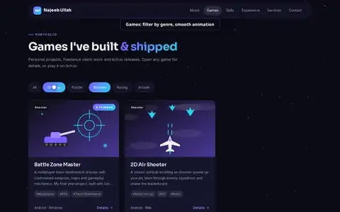</a><br>
<b>Landing page (desktop)</b><br><sub>Every section, navigation, genre filters, game page, 404 · <a href="videos/12-landing-page-desktop.mp4">full video</a></sub>
</td>
<td align="center" valign="top" width="50%">
<a href="videos/13-landing-page-mobile.mp4">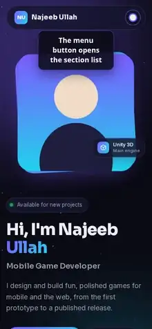</a><br>
<b>Landing page (mobile)</b><br><sub>Phone layout, menu, filters, game page · <a href="videos/13-landing-page-mobile.mp4">full video</a></sub>
</td>
</tr>
<tr>
<td align="center" valign="top" width="50%">
<a href="videos/01-login-and-overview.mp4">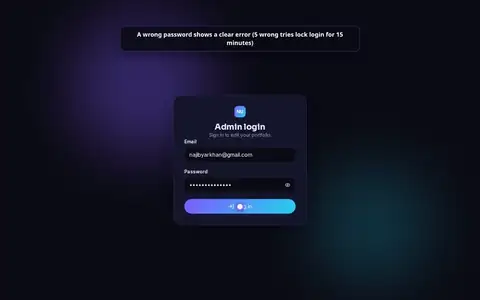</a><br>
<b>Login & overview</b><br><sub>Login, stat tiles, setup checklist, quick actions · <a href="videos/01-login-and-overview.mp4">full video</a></sub>
</td>
<td align="center" valign="top" width="50%">
<a href="videos/02-profile.mp4">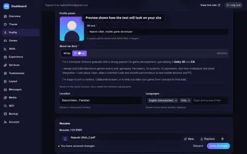</a><br>
<b>Profile</b><br><sub>Photo, bio, resume (single file), hero, contact, socials, stats · <a href="videos/02-profile.mp4">full video</a></sub>
</td>
</tr>
<tr>
<td align="center" valign="top" width="50%">
<a href="videos/03-games.mp4">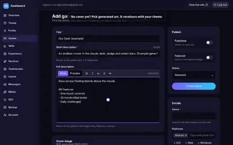</a><br>
<b>Games</b><br><sub>Add a game with cover, screenshots, trailer, links; reorder; publish · <a href="videos/03-games.mp4">full video</a></sub>
</td>
<td align="center" valign="top" width="50%">
<a href="videos/04-skills.mp4">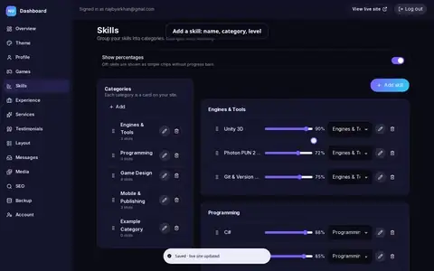</a><br>
<b>Skills</b><br><sub>Categories, levels, moving & reordering, percentages toggle · <a href="videos/04-skills.mp4">full video</a></sub>
</td>
</tr>
<tr>
<td align="center" valign="top" width="50%">
<a href="videos/05-experience.mp4">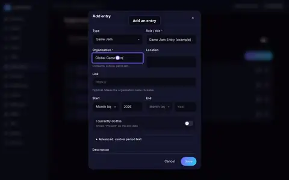</a><br>
<b>Experience</b><br><sub>Timeline entries, dates / “Present”, auto-sort · <a href="videos/05-experience.mp4">full video</a></sub>
</td>
<td align="center" valign="top" width="50%">
<a href="videos/06-services.mp4">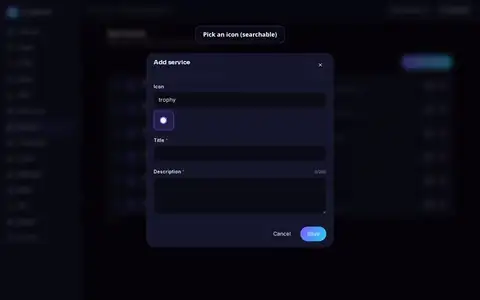</a><br>
<b>Services</b><br><sub>Icon picker, reorder, live view · <a href="videos/06-services.mp4">full video</a></sub>
</td>
</tr>
<tr>
<td align="center" valign="top" width="50%">
<a href="videos/07-testimonials.mp4">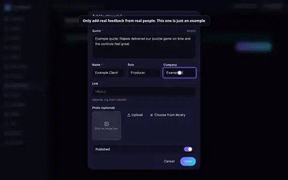</a><br>
<b>Testimonials</b><br><sub>Quote with photo, publish, enabling the section · <a href="videos/07-testimonials.mp4">full video</a></sub>
</td>
<td align="center" valign="top" width="50%">
<a href="videos/08-layout.mp4">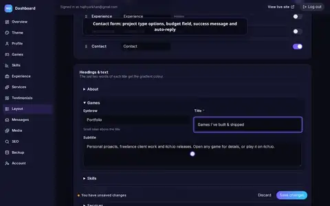</a><br>
<b>Layout</b><br><sub>Reorder / hide / rename sections, headings, contact & display options · <a href="videos/08-layout.mp4">full video</a></sub>
</td>
</tr>
<tr>
<td align="center" valign="top" width="50%">
<a href="videos/09-theme-studio.mp4">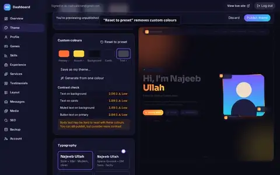</a><br>
<b>Theme Studio</b><br><sub>Presets, custom colours, contrast, fonts, effects, light/dark, publish · <a href="videos/09-theme-studio.mp4">full video</a></sub>
</td>
<td align="center" valign="top" width="50%">
<a href="videos/10-media-library.mp4">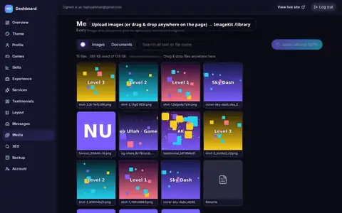</a><br>
<b>Media library</b><br><sub>ImageKit uploads, alt text, “Used in” links, delete · <a href="videos/10-media-library.mp4">full video</a></sub>
</td>
</tr>
<tr>
<td align="center" valign="top" width="50%">
<a href="videos/11-seo.mp4">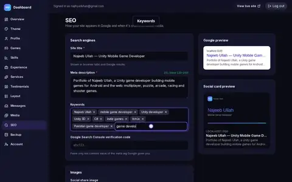</a><br>
<b>SEO</b><br><sub>Title, description, keywords, share image, favicon, analytics · <a href="videos/11-seo.mp4">full video</a></sub>
</td>
<td align="center" valign="top" width="50%">
<a href="videos/14-contact-and-messages.mp4">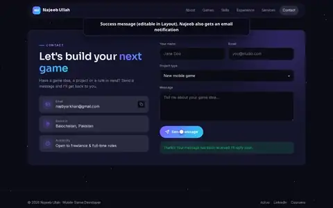</a><br>
<b>Contact & messages</b><br><sub>Visitor message → inbox: read, reply, archive, search, CSV · <a href="videos/14-contact-and-messages.mp4">full video</a></sub>
</td>
</tr>
<tr>
<td align="center" valign="top" width="50%">
<a href="videos/15-backup-and-restore.mp4">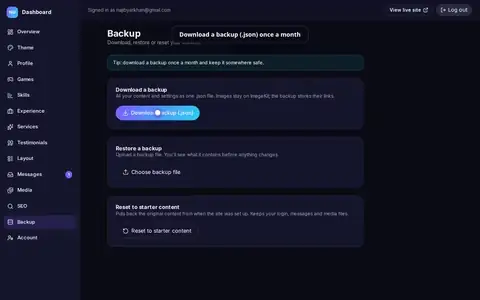</a><br>
<b>Backup & restore</b><br><sub>Download, restore with confirmation, reset · <a href="videos/15-backup-and-restore.mp4">full video</a></sub>
</td>
<td align="center" valign="top" width="50%">
<a href="videos/16-admin-on-mobile.mp4">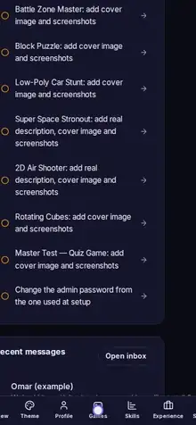</a><br>
<b>Dashboard on a phone</b><br><sub>Bottom tabs, editing, save bar, Theme Studio, inbox · <a href="videos/16-admin-on-mobile.mp4">full video</a></sub>
</td>
</tr>
<tr>
<td align="center" valign="top" width="50%">
<a href="videos/17-account.mp4">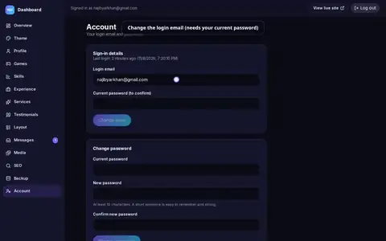</a><br>
<b>Account</b><br><sub>Email & password change, strength meter, log out everywhere · <a href="videos/17-account.mp4">full video</a></sub>
</td>
<td width="50%"></td>
</tr>
</table>

## Local setup

Requirements: Node 22+ (24 recommended), pnpm 10, MongoDB (local or Atlas).

```bash
pnpm install
cp .env.example .env.local      # fill in the values (see below)
pnpm seed                       # starter content (+ uploads the resume to ImageKit if configured)
pnpm create-admin               # creates the admin from ADMIN_EMAIL / ADMIN_PASSWORD (min 10 chars)
pnpm dev                        # http://localhost:3000 — admin at /admin
```

| Variable | Required | Notes |
|---|---|---|
| `MONGODB_URI` | ✔ | e.g. `mongodb://127.0.0.1:27017/najeeb_portfolio` or an Atlas URI |
| `AUTH_SECRET` | ✔ | `openssl rand -base64 32` |
| `NEXT_PUBLIC_SITE_URL` | ✔ in prod | Used for canonical URLs, sitemap, OG |
| `IMAGEKIT_PUBLIC_KEY`, `IMAGEKIT_PRIVATE_KEY`, `IMAGEKIT_URL_ENDPOINT` | for uploads | Without them the site works but uploads are disabled |
| `IMAGEKIT_ROOT_FOLDER` | | Default `/najeeb-portfolio` |
| `IMAGEKIT_MAX_STORAGE_MB` | | Optional cap on storage used by the site |
| `RESEND_API_KEY`, `EMAIL_FROM`, `CONTACT_TO_EMAIL` | for email | `EMAIL_TRANSPORT=log` prints emails instead of sending |
| `IP_HASH_SALT` | ✔ in prod | Any long random string (contact/login rate limiting) |
| `ADMIN_EMAIL`, `ADMIN_PASSWORD` | for `create-admin` | Remove the password after use |
| `TURNSTILE_*`, `NEXT_PUBLIC_ANALYTICS` | optional | See DECISIONS.md |

## Commands

```bash
pnpm dev            # dev server
pnpm build          # production build
pnpm lint           # eslint
pnpm typecheck      # next typegen + tsc --noEmit
pnpm test           # vitest unit tests
pnpm test:e2e       # playwright (builds & serves on :3100 against najeeb_portfolio_test)
pnpm seed           # idempotent seed; `pnpm seed --force` resets all content
pnpm create-admin   # create / reset the admin user (also logs out other sessions)
```

## How it fits together

- **Public pages** (`src/app/(site)`) are static and tag-cached (`unstable_cache`). Every admin mutation calls `expire(tag)` → the next visitor sees the change. No DB query per visitor.
- **Theme**: settings → `buildTheme()` (`src/lib/theme`) → CSS variables in a `<style>` in `<head>`. Components only use tokens (`bg-surface`, `var(--primary)`…).
- **Admin** (`src/app/admin`) is dynamic; mutations are server actions in `src/server/actions`, each doing session check → Zod → write → revalidate → typed `ActionResult`.
- **Media**: browser uploads straight to ImageKit with a short-lived signature from `/api/upload/auth`; `registerUpload` verifies and records it (`media` collection). Folders: `profile/`, `resume/`, `games/<slug>/cover|screenshots/`, `testimonials/`, `seo/`, `library/`. Only one resume exists at any time.
- **Preview**: `/preview` renders the home page with the unpublished theme draft; the Theme Studio pushes CSS vars into it via `postMessage`.

## Deploying (Vercel + Atlas + ImageKit + Resend)

See `docs/07-QA-DEPLOYMENT.md` §7. In short: create the Atlas cluster, set all env vars in Vercel (Production + Preview), deploy, then run `pnpm seed` and `pnpm create-admin` locally with the production env loaded.
